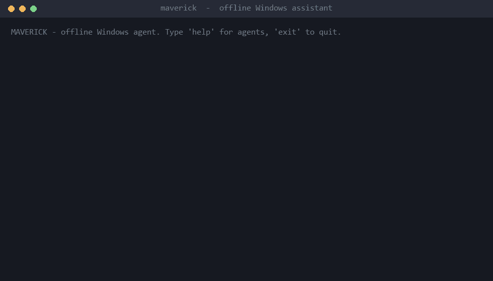
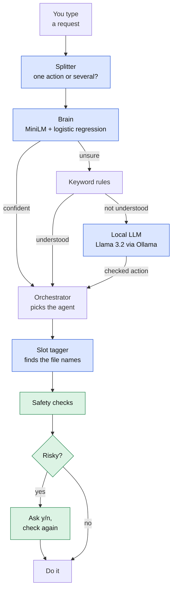

# MAVERICK


[](https://github.com/redrighthand2007/MAVERICK/releases)
[](LICENSE)

**An offline, multi-agent AI assistant for Windows.** Type what you want in plain English. MAVERICK
understands it with its own trained models, hands it to one of 14 specialist agents, checks it for
safety, asks before anything risky, and does it. No cloud, no API keys, nothing leaves your PC.

<p align="center"></p>
<p align="center"><sub>Real answers to real requests, on throwaway files in a demo folder.</sub></p>

| 91.6% | 14 agents | 2.5 ms | 491 tests |
|:---:|:---:|:---:|:---:|
| requests understood correctly<br>(5-fold cross-validation) | 46 operations, from files<br>to services and devices | per request for the<br>transformer brain, no PyTorch | every system call faked;<br>CI on Windows |

**Contents:** [Highlights](#highlights) · [How it works](#how-a-request-flows) ·
[Agents](#the-14-agents) · [Results](#results) · [Setup](#setup) · [Project layout](#project-layout)

## Highlights

- **Its own ML brain, measured honestly.** Request understanding went from **84.5% to 91.6%**
  (hard cases **75% → 86%**). Every model was scored the same way, with 5-fold cross-validation on
  1,374 labelled sentences, and replaced the current one only when it scored higher.
- **Classic ML written from scratch in NumPy, no scikit-learn:**
  - classifiers: Naive Bayes, logistic regression, SVM, k-NN, decision tree, an MLP with
    backpropagation, a soft-voting ensemble
  - inside the agents: isolation forest, k-means, regression, learning-to-rank, knapsack planning,
    constraint solving
- **A pretrained transformer, shipped without PyTorch.** The MiniLM sentence encoder is exported to
  ONNX (90 MB) and runs in 2.5 ms per request with `onnxruntime`. If it's missing, MAVERICK falls back
  to its own ensemble.
- **A local LLM as the last resort.** Llama 3.2 3B through Ollama, with tool calling, few-shot
  prompting (88% → 95%) and a multi-step agent loop. Every value the LLM proposes is checked against
  what you actually typed.
- **Safety first.**
  - It never overwrites, and never touches system folders or whole drives.
  - It asks y/n before anything risky, and deletes only to the Recycle Bin.
  - Passwords are typed at a hidden prompt and never logged.
- **Built to be trusted:** 491 tests, all system calls (processes, services, power, devices) faked,
  so the suite never changes your PC; CI on Windows with Python 3.12 and 3.14.

## How a request flows



The blue steps are the "AI", and they only **propose** an action. The green safety steps always run,
whoever proposed it. Understanding (`agent.py`) is kept separate from doing (`ops.py`), so nine
different models could be tried, and the brain replaced three times, without touching a single
operation.

## The 14 agents

| Agent | Try saying | What it does |
|---|---|---|
| Files | `copy notes.txt to D:\backup`, `rename a.txt to b.txt`, `how big is D:\games` | Copy, move, rename, size; never overwrites |
| Search | `find pdfs from last week in downloads`, `group the files in my downloads` | By name, kind, date, size or text; results ranked by a learned model; k-means grouping |
| Archive | `zip D:\work with a password`, `what's inside backup.zip` | zip / tar / tar.gz, AES-256, list, extract with a Zip Slip guard |
| Cleanup | `free up 5 gb`, `clear temp files` | Optimal clean-up plan (knapsack, least "regret"); Recycle Bin only |
| Process | `kill chrome`, `what started code.exe`, `any unusual programs running` | Top programs, process tree, end, frozen apps, memory and handle leaks, anomaly detection |
| Hardware | `how much ram`, `is my laptop charging`, `when will C: be full` | RAM, slots, CPU, battery, disks, disk-full forecast (regression) |
| Power | `switch to power saver`, `set brightness to 40` | Windows 11 power modes, laptop brightness |
| Services | `restart the spooler service` | Show, start, stop, enable, disable; protects core Windows services |
| Network | `what's my ip`, `turn off wifi` | Adapters, IP, Wi-Fi name and signal, enable/disable |
| Devices | `show devices with problems`, `restart the webcam` | Device list, problem devices, restart a device |
| Accounts | `who has admin on this pc` | Administrators audit (read-only) |
| Watch | `move every new pdf in downloads to documents` | Background folder watcher |
| Logs | `rotate server.log when it gets bigger than 50 mb` | Log rotation to dated `.gz` copies |
| Jobs | `show background jobs`, `plan maintenance between 10 pm and 2 am` | Background jobs; schedule planning as a constraint problem |

Several actions in one sentence work too: `copy report.txt to backup and then zip it` copies the file,
then zips the copy ("it" means the previous step's result).

## Results

5-fold cross-validation on 1,374 labelled sentences (46 operations + "unknown"), plus 84 hand-picked
hard cases that are never trained on. "As MAVERICK runs" means the brain plus keyword rules, which is
what you actually get.

| Brain | As MAVERICK runs | Hard cases |
|---|---|---|
| Naive Bayes (first brain) \* | 83.8% | 60% |
| Logistic regression + word pairs, TF-IDF | 83.2% | 73% |
| Ensemble: LR + Bernoulli NB + linear SVM | 84.5% | 75% |
| **MiniLM (ONNX) + logistic regression (current)** | **91.6%** | **86%** |

\* measured earlier, on a smaller dataset; the other rows use the final 1,374 sentences.

| Other models | Score |
|---|---|
| Slot tagger (file names, BIO + Viterbi) | 93.0% of sentences fully right vs 79.0% for regex |
| Multi-action splitter (stacking) | 95.8% of multi-step sentences cut right |
| LLM tool calling, zero-shot → few-shot | 88.1% → 95.2% fully right |
| Learning-to-rank for search results | MRR 0.718 vs 0.339 in disk order |
| Anomaly detection (isolation forest) | 3 planted programs ranked 3rd, 5th, 6th of 113 |

Every experiment, including what failed and why: [docs/RESULTS.md](docs/RESULTS.md).

## Setup

Needs **Windows 10/11** and **Python 3.12+** (developed on 3.14).

```powershell
git clone https://github.com/redrighthand2007/MAVERICK.git
cd MAVERICK
pip install -e .              # or: pip install -r requirements.txt
python -m maverick.brain.train
python -m maverick.brain.multi
maverick                      # or: python maverick\main.py
```

`python -m maverick.brain.train` trains the brain. `python -m maverick.brain.multi` trains the
splitter, which reads the brain's answers, so it goes second. Training takes about a minute, and the
trained files stay on your PC (`maverick/brain/models/`, gitignored).

Admin-only actions (services, network adapters, device restarts) say so, and need MAVERICK to run as
Administrator.

<details>
<summary><b>Optional extras</b>: the MiniLM brain, the local LLM, the slot tagger</summary>

| Extra | What it adds | How |
|---|---|---|
| MiniLM brain (91.6% instead of 84.5%) | Better understanding of unusual wording | `pip install -e .[minilm]`, then once in an environment with PyTorch: `pip install -e .[train]` and `python -m maverick.llm.export_onnx`, then train again |
| Local LLM | Last-resort understanding, multi-step requests | Install [Ollama](https://ollama.com), then `ollama pull llama3.2:3b` |
| Slot tagger | Learned file-name extraction | `python -m maverick.brain.slots` |

</details>

<details>
<summary><b>Other ways to run it</b></summary>

```powershell
maverick "copy notes.txt to D:\backup"   # one request, then exit
maverick --background                    # only the saved background jobs (watchers, log rotation)
python -m pytest -q                      # the test suite (~5 min)
python -m maverick.brain.evaluate        # compare every brain kind side by side
python -m maverick.brain.review          # correct the brain's least-confident real requests
```

</details>

### Teaching it your own words

Real requests are logged to `maverick/brain/data/inbox.tsv` (gitignored, stays on your PC).
`python -m maverick.brain.review` shows the ones the brain was least sure about first (active
learning). Confirm or correct each one, then retrain. With MiniLM, retraining takes seconds and needs
no GPU.

## Project layout

```text
maverick/
  main.py              entry point: chat, one-shot, --background; registers the agents
  core/                Intent / Result / SubAgent, orchestrator, safety checks, background jobs, y/n
  agents/<name>/       agent.py (understands the request) + ops.py (does it): 14 agents
  brain/               every ML model, written from scratch, plus training, evaluation and review
  brain/data/          labelled training data (intents, hard cases, slots, multi-action, LLM eval)
  llm/                 Ollama client, tool calling, agent loop, LoRA experiment, MiniLM + ONNX export
tests/                 pytest suite; system calls are faked
docs/                  vision, brain roadmap, results, demo
```

**More reading:**
- [docs/VISION.md](docs/VISION.md): what MAVERICK is and its design rules
- [docs/BRAIN_ROADMAP.md](docs/BRAIN_ROADMAP.md): how the brain grew, from Naive Bayes to MiniLM
- [docs/RESULTS.md](docs/RESULTS.md): every experiment and its numbers, including what failed
- [CHANGELOG.md](CHANGELOG.md): what each version contains
- [CONTRIBUTING.md](CONTRIBUTING.md): running the tests, adding an agent

## License

[MIT](LICENSE) © 2026 Kush Aghera
