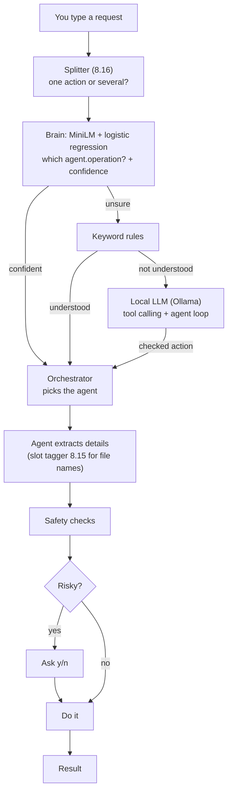

# MAVERICK

[](https://github.com/redrighthand2007/MAVERICK/actions/workflows/tests.yml)


[](LICENSE)

**An offline, multi-agent AI assistant for Windows.** Type what you want in plain English. MAVERICK
understands it with its own trained models, hands it to one of 14 specialist agents, checks it for
safety, asks before anything risky, and does it. No cloud, no API keys, nothing leaves your PC.

<!-- DEMO GIF: record it with docs/DEMO.md and save it as docs/demo.gif. Then delete these two
     lines and the closing line below the image, so the image line shows.
<p align="center"></p>
-->

```text
you> clone notes.txt into D:\backup
MAVERICK: Copied C:\Users\you\notes.txt -> D:\backup\notes.txt

you> duplicate notes.txt into D:\backup
MAVERICK: Blocked for safety: D:\backup\notes.txt already exists; MAVERICK never overwrites.

you> is my laptop charging
MAVERICK: Battery: 80%, plugged in, charging

you> free up 5 gb on c drive
MAVERICK: To free 5.00 GB, the least-missed choice is 33 item(s), 5.24 GB in all:
  -    1.08 GB  C:\idea-2026.1.2.exe  (would you miss it: 0.3)
  ... (y/n)
```

## Highlights

- **Own ML brain, built from scratch.** Intent classification climbed from 73% (Naive Bayes) to
  **91.6%** (a pretrained MiniLM encoder plus logistic regression). Every model was measured the same
  way, with 5-fold cross-validation, and replaced the old one only when it scored higher.
- **Classic ML in pure NumPy.** Naive Bayes, logistic regression, SVM, k-NN, decision tree, MLP with
  backpropagation, an ensemble, isolation forest, k-means, regression and learning-to-rank. No
  scikit-learn.
- **Local LLM as a last resort.** Llama 3.2 3B through Ollama, with tool calling, few-shot prompting
  (88% → 95%) and a multi-step agent loop. Every value the LLM proposes is checked against what you
  actually typed.
- **Pretrained transformer shipped without PyTorch.** MiniLM is exported to ONNX (90 MB) and runs in
  2.5 ms per request with `onnxruntime`. If it's missing, MAVERICK falls back to its own ensemble.
- **Safety first.** It never overwrites, never touches system folders or whole drives, asks y/n before
  risky actions, and deletes only to the Recycle Bin. Passwords are typed at a hidden prompt and never
  logged.
- **490 tests.** All system calls (processes, services, power, devices) are faked in tests, so the
  suite never changes your PC.

## How a request flows



Only the brain, the slot tagger, the splitter and the LLM are "AI". The agents themselves are plain,
testable Python: understanding (`agent.py`) is kept separate from doing (`ops.py`).

## The 14 agents

| Agent | Try saying | What it does |
|---|---|---|
| Files | `copy notes.txt to D:\backup`, `rename a.txt to b.txt`, `how big is D:\games` | Copy, move, rename, size; never overwrites |
| Search | `find pdfs from last week in downloads`, `group the files in my downloads` | By name, kind, date, size or text; results ranked by a learned model; k-means grouping |
| Archive | `zip D:\work with a password`, `what's inside backup.zip` | zip / tar / tar.gz, AES-256, list, extract with a Zip Slip guard |
| Cleanup | `free up 5 gb`, `clear temp files` | Optimal clean-up plan (knapsack, least "regret"); Recycle Bin only |
| Process | `kill chrome`, `what started code.exe`, `any unusual programs running` | Top programs, process tree, end, frozen apps, memory and handle leaks, anomaly detection |
| Hardware | `how much ram`, `is my laptop charging`, `when will C: be full` | RAM, slots, CPU, battery, disks, disk-full forecast (regression) |
| Power | `switch to power saver`, `set brightness to 40` | Windows 11 power modes, laptop brightness |
| Services | `restart the spooler service` | Show, start, stop, enable, disable; protects core Windows services |
| Network | `what's my ip`, `turn off wifi` | Adapters, IP, Wi-Fi name and signal, enable/disable |
| Devices | `show devices with problems`, `restart the webcam` | Device list, problem devices, restart a device |
| Accounts | `who has admin on this pc` | Administrators audit (read-only) |
| Watch | `move every new pdf in downloads to documents` | Background folder watcher |
| Logs | `rotate server.log when it gets bigger than 50 mb` | Log rotation to dated `.gz` copies |
| Jobs | `show background jobs`, `plan maintenance between 10 pm and 2 am` | Background jobs; schedule planning as a constraint problem |

## Results

5-fold cross-validation on 1,374 labelled sentences (46 operations + "unknown"), plus 84 hand-picked
hard cases. "As MAVERICK runs" means brain + keyword rules together. Full write-up:
[docs/RESULTS.md](docs/RESULTS.md).

| Brain | As MAVERICK runs | Hard cases |
|---|---|---|
| Naive Bayes (first brain) * | 83.8% | 60% |
| Logistic regression + word pairs, TF-IDF | 83.2% | 73% |
| Ensemble: LR + Bernoulli NB + linear SVM | 84.5% | 75% |
| **MiniLM (ONNX) + logistic regression (current)** | **91.6%** | **86%** |

\* measured earlier, on a smaller dataset; the other rows use the final 1,374 sentences.

| Other models | Score |
|---|---|
| Slot tagger (file names, BIO + Viterbi) | 93.0% of sentences fully right vs 79.0% for regex |
| Multi-action splitter (stacking) | 95.8% of multi-step sentences cut right |
| LLM tool calling, zero-shot → few-shot | 88.1% → 95.2% fully right |
| Learning-to-rank for search results | MRR 0.718 vs 0.339 in disk order |

## Setup

Needs **Windows 10/11** and **Python 3.12+** (developed on 3.14).

```powershell
git clone https://github.com/redrighthand2007/MAVERICK.git
cd MAVERICK
pip install -e .              # or: pip install -r requirements.txt
python -m maverick.brain.train
python -m maverick.brain.multi
maverick                      # or: python maverick\main.py
```

`python -m maverick.brain.train` trains the brain. `python -m maverick.brain.multi` trains the
splitter, which reads the brain's answers, so it goes second. Training takes about a minute; the
trained files stay on your PC (`maverick/brain/models/`, gitignored).

**Optional extras:**

| Extra | What it adds | How |
|---|---|---|
| MiniLM brain (91.6% instead of 84.5%) | Better understanding of unusual wording | `pip install -e .[minilm]`, then once in an environment with PyTorch: `pip install -e .[train]` and `python -m maverick.llm.export_onnx`, then train again |
| Local LLM | Last-resort understanding, multi-step requests | Install [Ollama](https://ollama.com), then `ollama pull llama3.2:3b` |
| Slot tagger | Learned file-name extraction | `python -m maverick.brain.slots` |

Admin-only actions (services, network adapters, device restarts) say so and need MAVERICK to run as
Administrator.

**Other ways to run it:**

```powershell
maverick "copy notes.txt to D:\backup"   # one request, then exit
maverick --background                    # only the saved background jobs (watchers, log rotation)
python -m pytest -q                      # the test suite (~5 min)
python -m maverick.brain.evaluate        # compare every brain kind side by side
python -m maverick.brain.review          # correct the brain's least-confident real requests
```

## Teaching it your own words

Real requests are logged to `maverick/brain/data/inbox.tsv` (gitignored, stays on your PC).
`python -m maverick.brain.review` shows the ones the brain was least sure about first (active
learning). Confirm or correct each one, then retrain. With MiniLM, retraining takes seconds and needs
no GPU.

## Project layout

```text
maverick/
  main.py              entry point: chat, one-shot, --background; registers the agents
  core/                Intent / Result / SubAgent, orchestrator, safety checks, background jobs, y/n
  agents/<name>/       agent.py (understands the request) + ops.py (does it): 14 agents
  brain/               every ML model, written from scratch, plus training, evaluation and review
  brain/data/          labelled training data (intents, hard cases, slots, multi-action, LLM eval)
  llm/                 Ollama client, tool calling, agent loop, LoRA experiment, MiniLM + ONNX export
tests/                 pytest suite; system calls are faked
docs/                  vision, brain roadmap, results, demo script
PROGRESS.md            every step, what it means and what it scored
```

## Documentation

- [docs/VISION.md](docs/VISION.md): what MAVERICK is and its design rules
- [docs/BRAIN_ROADMAP.md](docs/BRAIN_ROADMAP.md): how the brain grew, from Naive Bayes to MiniLM
- [docs/RESULTS.md](docs/RESULTS.md): every experiment and its numbers, including what failed
- [PROGRESS.md](PROGRESS.md): the full build log, stage by stage

## License

[MIT](LICENSE) © 2026 Kush Aghera
